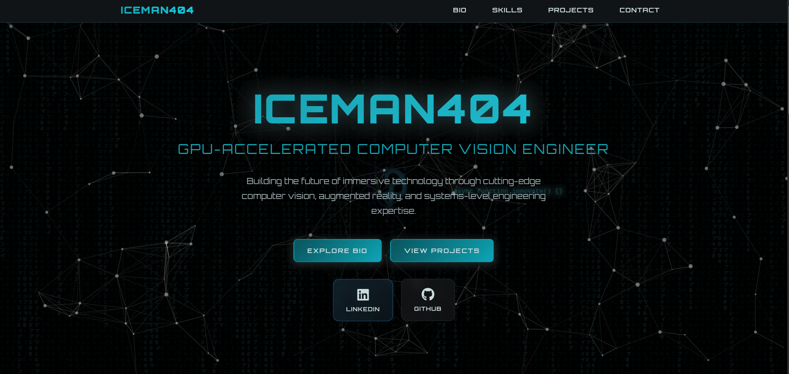
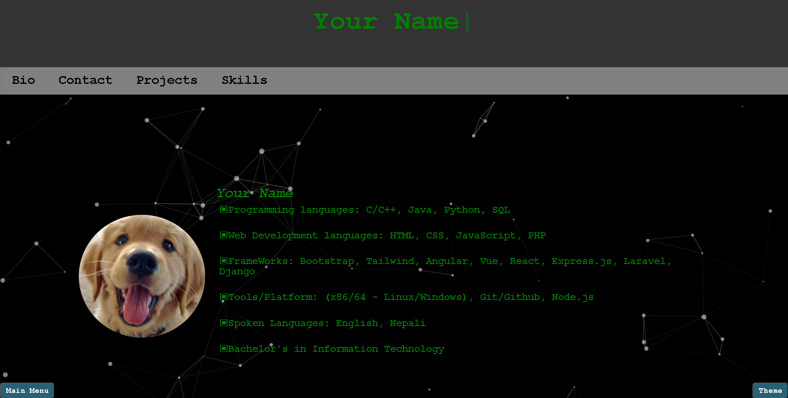
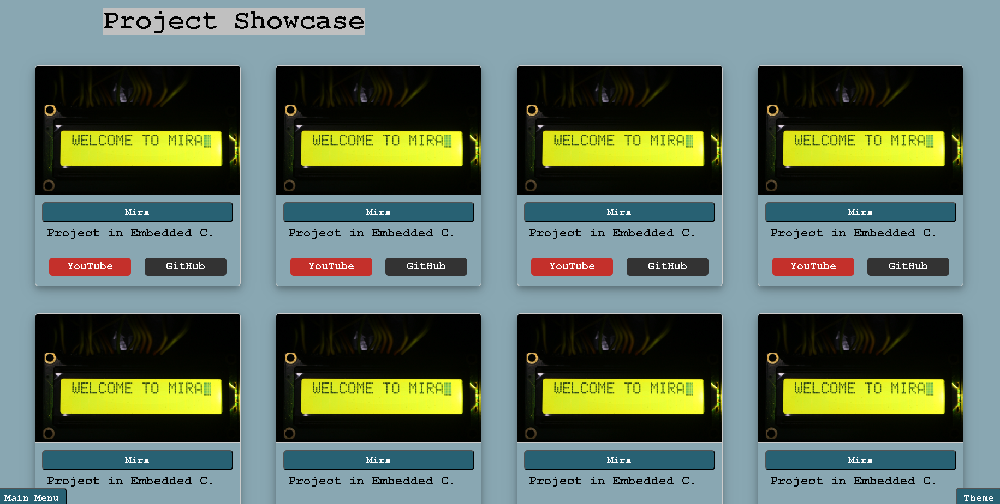
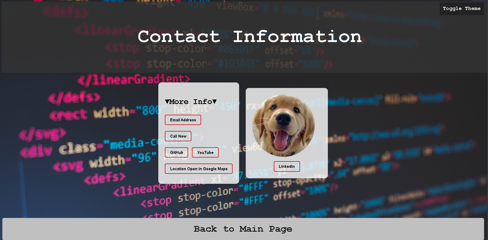
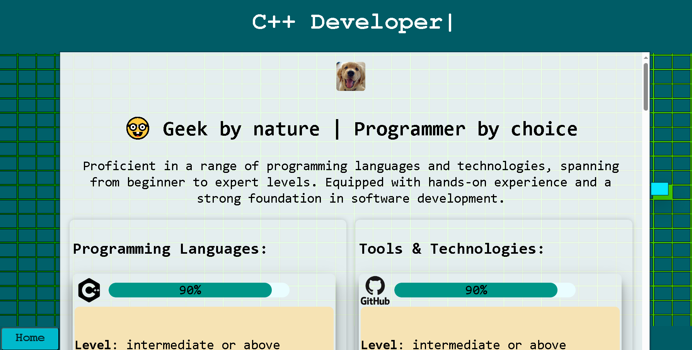

#  Creative Coder Portfolio

<div align="center">



**A modern, responsive portfolio website built with vanilla HTML, CSS, and JavaScript**

[](http://creativecommons.org/licenses/by/3.0/)
[](https://developer.mozilla.org/en-US/docs/Web/HTML)
[](https://developer.mozilla.org/en-US/docs/Web/CSS)
[](https://developer.mozilla.org/en-US/docs/Web/JavaScript)

</div>

---

##  Table of Contents

- [Overview](#-overview)
- [Features](#-features)
- [Screenshots](#-screenshots)
- [Getting Started](#-getting-started)
- [Project Structure](#-project-structure)
- [Customization Guide](#-customization-guide)
- [Technologies Used](#-technologies-used)
- [Browser Support](#-browser-support)
- [Contributing](#-contributing)
- [License](#-license)
- [Contact](#-contact)

---

##  Overview

**Creative Coder Portfolio** is a fully responsive, modern portfolio website template designed for developers, designers, and creative professionals. Built entirely with vanilla web technologies (no frameworks required), this portfolio offers a clean, professional design with smooth animations and interactive elements.

### Why This Portfolio?

- **Pure Vanilla**: No dependencies, no build process, just pure HTML, CSS, and JavaScript
- **Fully Responsive**: Works seamlessly on desktop, tablet, and mobile devices
- **SEO Optimized**: Includes proper meta tags, structured data, and breadcrumb navigation
- **Performance Focused**: Lightweight and fast-loading
- **Easy to Customize**: Well-organized code with clear comments
- **Modern Design**: Beautiful UI with particle effects and smooth animations

---

##  Features

###  Design & UI
- **Particle.js Background**: Interactive particle animation background
- **Smooth Animations**: Typing effects, hover animations, and transitions
- **Dark/Light Theme**: Toggle between themes with a single click
- **Responsive Layout**: Mobile-first design that adapts to all screen sizes
- **Modern Typography**: Clean, readable fonts with proper hierarchy

###  Responsive Features
- **Mobile Optimized**: Specially designed mobile layout with proper spacing
- **Touch Friendly**: All interactive elements are optimized for touch devices
- **Flexible Grid**: Project showcase adapts to screen size
- **Scroll Optimization**: Smooth scrolling with proper viewport handling

###  Technical Features
- **SEO Ready**: Complete meta tags, Open Graph, and structured data (Schema.org)
- **Breadcrumb Navigation**: Proper breadcrumb implementation for better SEO
- **Accessibility**: Semantic HTML and ARIA labels where appropriate
- **Performance**: Optimized images and minimal external dependencies
- **Cross-browser Compatible**: Works on all modern browsers

###  Sections
- **Hero Section**: Animated header with typing effect
- **Profile Section**: Personal information with expandable accordions
- **Projects Showcase**: Grid layout with project cards and lightbox gallery
- **Skills Section**: Interactive skill display with progress indicators
- **Contact Form**: Integrated contact form with Formspree
- **Bio Page**: Separate bio page with typing animations

---

##  Screenshots

<div align="center">

| Desktop View | Mobile View |
|:---:|:---:|
|  |  |
|  |  |
|  | |

</div>

---

##  Getting Started

### Prerequisites

- A modern web browser (Chrome, Firefox, Safari, Edge)
- A text editor (VS Code, Sublime Text, etc.)
- Basic knowledge of HTML, CSS, and JavaScript

### Installation

1. **Clone the repository:**
   ```bash
   git clone https://github.com/iceman404/Creative-Coder-Portfolio.git
   ```

2. **Navigate to the project directory:**
   ```bash
   cd Creative-Coder-Portfolio
   ```

3. **Open in your browser:**
   - Simply open `index.html` in your preferred web browser
   - Or use a local server:
     ```bash
     # Using Python
     python -m http.server 8000
     
     # Using Node.js (http-server)
     npx http-server
     
     # Using PHP
     php -S localhost:8000
     ```

4. **Start customizing:**
   - Edit `index.html` to add your content
   - Modify CSS in the `<style>` section
   - Update JavaScript functions as needed

---

##  Project Structure

```
Creative-Coder-Portfolio/
│
├── index.html              # Main homepage
├── bio.html                # Bio page
├── contacts.html           # Contact page
├── skills.html             # Skills page
├── 404.html               # 404 error page
│
├── css/
│   └── style.css          # Particle.js styles
│
├── images/
│   ├── profile/           # Profile images
│   ├── background/        # Background images
│   └── favicon/          # Favicon files
│
├── project-html-files/    # Individual project pages
│   ├── mira.html
│   ├── lora_geofencing.html
│   └── ...
│
├── project-screenshots-files/  # Project screenshots
│
├── assets/
│   └── icon-images/       # Technology icons
│
├── particle.js/           # Particle.js library
│   └── app.js
│
├── resume/               # Resume files
├── screenshots/          # Portfolio screenshots
│
├── robots.txt           # SEO robots file
├── sitemap.xml          # SEO sitemap
├── site.webmanifest     # PWA manifest
└── README.md            # This file
```

---

##  Customization Guide

### 1. Personal Information

#### Update Header (`index.html`)
```html
<!-- Line ~773: Update the typing text -->
const nameText = "Hi... I'm YourName";
```

#### Update Profile Section (`index.html`)
```html
<!-- Line ~610: Update your name -->
<em>Real Name: Your Name</em>

<!-- Update profile image path -->

```

### 2. Navigation Links

Edit the navigation menu in `index.html`:
```html
<nav>
  <a href="/bio">Bio</a>
  <a href="/contacts">Contact</a>
  <a href="#projects">Projects</a>
  <a href="/skills">Skills</a>
</nav>
```

### 3. Projects Section

#### Add/Remove Projects
1. Add project images to `project-screenshots-files/`
2. Create project detail pages in `project-html-files/`
3. Update the project grid in `index.html` (around line 637):
```html
<div class="project-item">
  
  <div class="project-details">
    <button onclick="handleProjectSelection('project-html-files/your-project')">
      Project Name
    </button>
    <div class="buttons">
      <a href="YOUTUBE_LINK" class="youtube-btn">YouTube</a>
      <a href="GITHUB_LINK" class="github-btn">GitHub</a>
    </div>
  </div>
</div>
```

### 4. Skills Section

Edit `skills.html`:
- Update skill names and percentages
- Modify skill descriptions in the `<pre>` tags
- Add/remove skill cards as needed
- Update skill icons in `assets/icon-images/`

**Note:** Keep skill descriptions to 3 words per line for best formatting.

### 5. Styling

All styles are internal in `index.html` for easy customization:
- **Colors**: Modify CSS variables or direct color values
- **Fonts**: Change font-family in the style section
- **Layout**: Adjust widths, margins, and padding
- **Animations**: Modify transition and animation properties

### 6. Theme Customization

The dark theme can be customized in the `.dark-theme` class (around line 510):
```css
.dark-theme {
  background-color: #000;
  color: green;
}
```

### 7. SEO & Meta Tags

Update meta tags in the `<head>` section:
- Title and description
- Open Graph tags for social sharing
- Canonical URLs
- Structured data (Schema.org)

---

##  Technologies Used

- **HTML5**: Semantic markup and structure
- **CSS3**: Modern styling with Flexbox and Grid
- **JavaScript (ES6+)**: Interactive functionality
- **Particle.js**: Background particle effects
- **Font Awesome**: Icon library
- **Formspree**: Contact form handling

### External Services
- Google Custom Search (optional)
- Formspree for contact forms

---

##  Browser Support

| Browser | Version |
|---------|---------|
| Chrome | Latest |
| Firefox | Latest |
| Safari | Latest |
| Edge | Latest |
| Opera | Latest |

---

##  Contributing

Contributions are welcome! If you'd like to contribute:

1. Fork the repository
2. Create a feature branch (`git checkout -b feature/AmazingFeature`)
3. Commit your changes (`git commit -m 'Add some AmazingFeature'`)
4. Push to the branch (`git push origin feature/AmazingFeature`)
5. Open a Pull Request

### Contribution Guidelines
- Follow the existing code style
- Add comments for complex functionality
- Test on multiple browsers
- Update documentation as needed

---

##  License

This project is licensed under the Creative Commons Attribution 3.0 License.

See the [LICENSE.txt](./LICENSE.txt) file for details.

---

##  Contact

**John Subba (iceman404)**

<div align="center">

[](https://github.com/iceman404)
[](mailto:johnsubba404@gmail.com)
[](https://www.linkedin.com/in/john-subba-ic3man404/)
[](https://twitter.com/ic3man404)

</div>

---

##  Notes

- **Experience Section**: Not included in current version but can be easily added as a new navigation link with a separate HTML file
- **Resume Download**: PDF file should be placed in the `resume/` directory
- **Project Images**: Use `.avif` format for optimal performance, with fallbacks if needed
- **Custom Domain**: Update all URLs in breadcrumbs and canonical tags when deploying

---

<div align="center">

**Made with ❤️ by [iceman404](https://github.com/iceman404)**

 Star this repo if you find it helpful!

</div>
